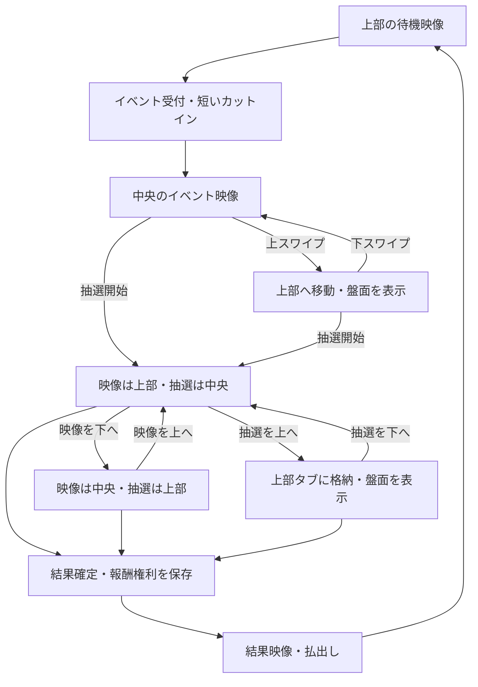

# イベント映像・スワイプ移動・3Dボール抽選の実装準備

## 2026-10-16 制作方式の更新（旧記述より優先）

ユーザー承認済みの最新の漫画風キャラクターで、背景・平面立ち絵・小物・吹き出しを別々に組み、縦の中心軸で一回転して画像を切り替える**紙芝居方式**を採用する。MP4は初期の必須形式とせず、単一の演出状態を上部／中央へ移動する。途中の細目・ジト目の案は採用しない。旧C3参照は[最新の美術方針](CHARACTER_ART_DIRECTION.md)へ読み替える。

[紙芝居の絵コンテ・台詞・全39ポーズ・背景9枚の制作計画](PAPER_THEATER_STORYBOARDS.md)を追加した。本体の映像と3D抽選は引き続き未実装。

追加指示により、本体の10枚報酬も手持ち加算から左横射出の盤面払出しへ変更する。以下の旧記述の『手持ち10枚』は『盤面10枚』へ読み替える。抽選確率・通常球3個のJP進行・物理抽選の確定方式は変更しない。ミニボールは別の球として回収時に盤面10枚を予約し、通常球3個には数えない。無料の継続補充は手持ち追加のまま。タワー予定地は初期に空けず、実際の搬入時に空きを確認する。

2026-10-15。ユーザーの追加要望に基づく準備仕様。ゲーム本体への実装はまだ行わない。世界観は[潮待ち郵便局の案](EVENT_STORY_PROPOSAL.md)、絵の候補は[キャラクター美術方針](CHARACTER_ART_DIRECTION.md)を参照する。

## 1. 今回の要望として扱うこと

1. 報酬メダル供給口の上にあるスペースを、常設の小型イベントモニターにする。通常時にはキャラクターの待機映像を流す。
2. イベント発生時は短いカットインの後、画面中央でイベント映像を開始する。
3. 上スワイプで映像を上部へ移し、下スワイプで中央へ戻す。同じ映像の再生位置を引き継ぐ。
4. JPは文字の当落表示だけで終えず、ルーレットなどの過程を見て楽しめる抽選にする。
5. 3Dの球が実際に転がり、どの穴へ落ちるかを見る抽選を用意する。その開始時は映像を上部へ移し、新しい抽選ウィンドウを中央へ出す。
6. キャラクターは3人ともアニメ調C3を採用する。表情・ポーズとちびキャラを制作する。最終配当はまだ決めない。

この文書内の秒数・画面寸法・物理寸法は実装開始用の提案値。動作・性能の達成済み値ではない。

## 2. 実在機から参考にする構造

| 資料 | 確認できた仕組み | coinへ取り入れる部分 |
| --- | --- | --- |
| [フォーチュントリニティ 時空のダイヤモンド／公式](https://www.konami.com/amusement/corporate/ja/topics/20231120/) | 球を3個落とすとステーション抽選。異なるJP抽選機や、光・音・映像を連動させた払出しがある。 | 小イベントから大きな抽選へ進む段階、JP時の画面・BGM・払出しの同期。 |
| [GRANDCROSS GOLD コナステ版／公式](https://www.konami.com/amusement/corporate/ja/topics/20240802/) | 穴へ球を落とすことから始まる抽選、色による継続抽選、数字を利用するビンゴなど。 | 球・穴・当選枠を同時に見せ、結果が目で分かるデジタル3D抽選。 |
| [バベルのメダルタワーW！／公式](https://babeltower.sega.jp/) | オーブ3個からサテライトルーレットへ進む。 | ボール回収からルーレットへ移る見せ方。 |
| [初代バベルの開発記録／セガ公式](https://babeltower.sega.jp/babel/making/index06.html) | クルーンによるJP抽選と、長い待ち時間や演出中の遊びを見直した経緯。 | クルーンの期待感を生かしつつ、長い映像を上へ避けて盤面を見られる操作を用意する。 |
| [ガッ釣りGO！／公式](https://gutsrigo.sega.jp/guide/) | 金ボール5個の抽選進出、失敗後も残るサンステップなど。 | 球回収、抽選、次回へ残る進行を別々に表示する。 |

窓のスワイプ移動・二画面の入替え・郵便局の物語は、今回のcoin向け設計。実在機に同じUIがあると扱わない。素材やキャラクター、固有の画面を複製するものではなく、確認したゲーム構造を参考にする。

## 3. 画面を二種類に分ける

### StoryWindow：待機・会話・イベント映像

- 通常は上部モニター。ナギの仕分け、ミナの帰港、ガロの整備を短いループで流す。
- イベントで中央へ来る。キャラクターのカットイン、短い会話、出港準備、結果に合わせた反応を担当。
- 映像の字幕・移動ハンドル・上下移動ボタンを枠内へまとめる。
- 単なる一枚絵のフェードだけを完成ムービーと扱わない。待機も、呼吸・まばたき・手の作業・旗や帆の揺れのいずれかを含む。

### DrawWindow：デジタルルーレット・3Dボール抽選

- 必要な時だけ生成・表示する。ルーレット盤、球、ポケット、配当を見せる。
- StoryWindowとは別の表示枠で、同じ中央枠を奪い合って重ならないようにする。
- 3D抽選開始時の既定状態は、StoryWindowが上、DrawWindowが中央。
- 中央・上部を移動しても、抽選世界・球・経過時間・結果IDは同じものを維持する。

表示枠を移動することと、イベントの進行・抽選の開始を別の処理にする。位置の変更でイベントを作り直さない。

## 4. 配置と見た目

### 上部の常設モニター

報酬供給口の上という筐体内の関係を守る。供給口と投入レール終端を隠すHUDとして置くのではなく、背面カバーにモニター枠を追加し、その表示面へ映像を重ねる案を第一候補とする。

`BoardView`から背面モニターの画面上の投影範囲を渡し、DOMの映像枠をそこへ合わせる。将来のカメラ調整でも画面上の固定px座標へ取り残されないようにする。現在のレール終端と背面機構が近いため、**実際の画面でレール・供給口・モニターの重なりを確認してから位置とカメラを確定する**。

- モニター映像は16:9。深緑の薄い枠、サテン銀の縁、小さな真鍮の留め具。
- 既存の手持ち表示、抽選までの枚数、ボール進行は映像より外側で読めるようにする。
- 初期の上部枠の目安はステージ幅の約60%、幅上限280px。小さい横画面では幅120〜160pxへ縮める。
- 実装用の仮配置では上部に領域を予約し、盤面の投影を収め直す。モニターのためにコインや球を縮小しない。
- 上部に二つの内容が来る時は「映像／抽選」のタブを持つ一つのモニターにする。同時に二段へ積んで盤面を塞がない。

### 中央の映像・抽選枠

ステージ中央に置き、上の手持ち表示と下の投入モード・投入ボタンを覆わない。枠幅は概ねステージ幅から左右12pxずつを引いた値、上限560px。高さは16:9の本体と見出し・字幕を含めて実際の空き高さへ収める。縦に狭い時は本体サイズを優先して縮め、字幕は二行以内にする。

背景の盤面を暗くする場合も薄い影にとどめ、筐体の位置関係を見失わせない。フルスクリーンの白フラッシュ、常時の強い発光、画面全体の揺れは使わない。JPだけ枠内の真鍮色が暖かく明るくなる。

## 5. スワイプと窓の優先順位

下方向は「中央へ戻す」という意味で実装する。

| 操作・状況 | 中央 | 上部 |
| --- | --- | --- |
| 通常待機 | 盤面 | 待機映像 |
| イベント開始 | イベント映像 | 同じ映像の複製は表示しない |
| 中央の映像を上スワイプ | 盤面。抽選開始済みなら抽選 | イベント映像 |
| 上部の映像を下スワイプ | イベント映像 | 抽選中なら抽選を退避 |
| 3D抽選の開始 | 3D抽選 | イベント映像 |
| 中央の抽選を上スワイプ | 盤面 | 映像／抽選のタブ |
| 上部の抽選を下スワイプ | 3D抽選 | イベント映像 |
| 抽選の終了 | ユーザーの選んだ位置で結果表示 | 結果を見られるタブや表示を維持 |

- 移動ハンドルと、操作ボタン以外の映像面で縦ジェスチャーを受ける。目安は縦48px以上、縦移動が横の1.35倍以上。
- 盤面の左右ドラッグと入力先を分ける。窓上で始めたジェスチャーを盤面へ流さず、投入口を勝手に回さない。
- 1本のポインターを捕捉して処理し、横断スワイプ、二本指、OSによるキャンセルで重複遷移しない。
- 上下移動ボタンでも同じ操作ができる。PC・キーボード・支援技術から使える。
- 移動は200〜250ms程度。`prefers-reduced-motion`では即時または短いフェードにする。表示位置だけを変更し、物理世界の座標や重力は変えない。
- リサイズ・画面回転中のドラッグは取り消し、移動先へ収める。
- 結果が出たことだけで、ユーザーが上へ逃がした窓を毎回中央へ戻さない。「結果を見る」を出せるようにする。

## 6. 演出の流れ

演出時間の出発点：カットイン0.45〜0.7秒、通常イベントの導入1〜2秒、JP導入2〜3秒、結果表示2〜4秒。待機ループは6〜10秒程度。物理抽選は球の挙動に従い、結果を決めるためだけに尺へ押し込まない。

キャラクターの出番：通常抽選はナギ、ボール追加はミナ、タワーはガロ。JP導入はナギの出港宣言、上部でミナとガロが球の動きを見守り、結果後に対応する反応へ分岐する。JPが確定する前に成功専用映像を見せない。

## 7. メダル盤面・自動投入と演出の時計

現状の一つの`paused`だけでは、盤面を止めながらイベントを進められない。実装時はユーザーによる全体停止、イベント中の盤面停止、イベント世界の進行、映像の表示位置を分ける。

| 状態 | メダル物理 | 手動投入 | 自動投入 | 映像・抽選 |
| --- | --- | --- | --- | --- |
| 待機 | 進む | 可 | ユーザー設定に従う | 待機映像 |
| カットイン | 一時停止 | 停止 | 停止 | 進む |
| 中央のイベント映像 | 一時停止 | 停止 | 停止 | 進む |
| 映像だけ上部へ移動 | 再開 | 可 | 直前にONだった場合だけ再開 | 進む |
| 中央の3D抽選 | 一時停止 | 停止 | 停止 | 抽選世界だけ進む |
| 抽選を上部へ格納 | 最初は停止。「盤面を再開」で再開 | 再開操作後に可 | 再開操作前は停止。0枚停止は引き継ぐ | 抽選は進む |
| 設定・非表示・中断 | 全体停止 | 停止 | 停止 | 全体停止 |

窓を移動しただけで新たに自動ONにしない。0枚停止や再読込後OFFという現行ルールを維持する。盤面の時計が止まっている間は自動投入の位相も進まない。

イベント中に盤面を再開して新しい条件が成立した場合は、イベントID付きでキューへ保留する。実行中の抽選へ割り込ませず、獲得済みの抽選権利を捨てない。

## 8. デジタルルーレットと物理抽選を混同しない

### 通常の30枚イベント：デジタルの窓口くじ

現行の通常抽選表を参照する。重み付き抽選の結果を保存し、それに対応した枠で円盤や指針が止まる見せ方にする。これはデジタル抽選であり、球が結果を決めたようには見せない。小さな枠にも報酬名を読めるよう、円の外へラベルを出すなどして対応する。

当選枠へ停止した時点で結果映像へ進み、同じイベントIDで一度だけ報酬を適用する。演出をスキップしても、保存済み結果を引き直さない。

### ボール3個のJPチャンス：3Dクルーン「出港ドック」

初期の主案は、既存の3個によるJPチャンス権利をそのまま3D抽選へつなぐ。入口のルーレットを追加したせいで、既存の挑戦権利がさらに抽選で失われる形へ黙って変えない。

1. 中央のイベント映像で、ガロがドックのゲートを開く。
2. 映像枠を上部へ移し、中央へ3Dクルーンを出す。
3. 配当を各ポケットへ表示し、球を発射する前に配置を確定する。
4. 球が円盤・壁・穴の縁へ実際に当たりながら回る。
5. 穴へ十分落ちたことを物理センサーで確認して結果を決める。
6. 当選した穴、報酬、球を見せたまま、報酬権利を保存してから払出しへ進む。

JP直撃など既に確定した報酬を、負ける可能性のある物理抽選へ入れ直さない。確定JPは専用の出港成功映像と払出しを使う。

## 9. 3Dクルーンの形と物理

仮寸法はメートル基準。メダル盤面の直径基準とは別のRapierワールドを持ち、換算や重力を混ぜない。

| 部品 | 初期の提案値・構造 |
| --- | --- |
| 球 | 半径0.06m、質量0.12kg程度。CCD有効。 |
| 円盤 | 外半径0.60m。中央は少し高く、外へ緩く下がる面。 |
| 穴 | 10個、中心半径0.42m、穴半径0.075m程度。実際に球が通過できる隙間。 |
| 囲い | 外周の連続した壁と透明カバー。画面外への流出を防ぐ。 |
| 回転 | 位置制御のキネマティック剛体。開始前に固定した回転速度・向き・初期角度。 |
| 発射 | 円周側のシュートから接線方向に発射。初速・高さの小さなばらつきを開始前に保存。 |
| 計算 | まず1/120秒固定刻み。描画30/60fpsで抽選の計算刻みを変えない。 |

円盤を穴のない一枚の円柱コライダーで塞いではならない。穴の外側を分割した凸形状で支持面を作り、穴の縁・筒・下の受け皿に対応した当たり判定を用意する。見た目と同じ穴から球が落ちることを最初の検証対象にする。

当たり判定の例：球の中心が穴の筒内に入り、盤面から球半径以上下へ落ち、同じポケットで連続した数ステップを検出した時に確定する。縁をかすめた瞬間や一度の接触イベントだけで当選にしない。

球の落下先を後から変える力、当選穴への吸い寄せ、途中のテレポート、見えない当選用コライダー、保存済み結果へ合わせる軌道補正は使わない。

球が20秒を超えて停止・逸脱する場合は機構の不具合として記録する。結果未確定の状態を保存し、「再抽選」を明示して未課金の抽選権利を使い直す復旧手段を用意する。再抽選を通常の当落結果へ置き換えたり、特定結果だけをやり直したりしない。固定seedで起きる詰まりは検証で取り除く。

## 10. ポケットと配当の初期案

最初の物理試作では現行JPチャンスの報酬種別を利用する。10穴を「手持ち10枚×7」「盤面30枚×2」「JP300枚×1」とする案で、タワーは通常イベントでの搬入権を残す。前のストーリー案にあるタワー入り上位抽選は、基本機構の検証後に別のルール版として検討する。

穴の数の比率は、そのまま実際の入賞確率ではない。回転・発射・形状による偏りがあるため、**現在の70%／20%／10%を維持できたと扱わない**。多数のseed・全ポケットの入賞分布と期待払出しを記録し、仕様を確定する。確率を固定したい場合はデジタルルーレットを採用し、物理抽選と偽らない。

穴の配当は球を出す前に表示して固定する。抽選後にラベルを置き換えない。物理世界の乱数系列は通常イベント・ボール供給・映像の乱数から独立させる。

将来の発展は、倍率と配当を別々に抽選する二段階型、一定色まで継続する型、穴番号によるビンゴ型。初期版に全部を入れず、単球・10穴の確定を先に作る。

## 11. 既存の抽選・保存処理からの変更点

現在の`Game.tick()`はイベント開始時に結果を抽選し、短い経過時間で`apply()`する。これをそのまま使って物理抽選だけ後付けすると、当落が球より先に確定する。実装時の最重要変更はここにある。

- チケットにルール版と解決方式を持たせる。デジタルは保存した抽選結果、物理は未確定から始め、ポケットの検出で初めて結果を持つ。
- 演出の経過時間ではなく、結果確定と報酬適用の段階を明示する。
- チケットID、映像の段階、現在の中央ウィンドウ、上部タブ、ルーレットの初期条件、物理ワールド、検出候補の穴、確定結果、報酬適用済みフラグをまとめて保存する。
- 盤面ワールドと抽選ワールドを、ゲーム状態と同じIndexedDBトランザクションで保存する。
- 報酬の手持ち加算・タワー予約・JP払出し権利はイベントIDで一度だけ適用する。払出し途中の再読込で残数を増やさない。
- 旧セーブに既に入っている抽選結果は引き継ぐ。既に確定済みの旧チケットを新しい物理抽選として引き直さず、従来の結果受取りとして完了させる。
- 保存形式を更新する際は、`SaveStore.compatible()`の単純な版不一致拒否だけで済ませず、旧形式からの移行処理を用意する。
- 音・映像・窓の位置が変わっても、物理抽選の乱数や報酬は変わらない。

映像のスキップは導入や結果の尺を短くする操作。進行中の物理抽選を別の確率抽選へ置き換えない。初期版では物理抽選のスキップを設けず、上部へ移して観察を続けられるようにする。

## 12. 映像と音の制作準備

初期の制作単位は、待機ループ3本、カットイン3種類、通常導入1本、JP導入1本、結果反応3種類、タワー搬入反応1本。採用したC3を固定し、正面・斜め・横と表情差分を作る。

- まず720p・30fpsの短いH.264/MP4とポスター画像を候補にする。ゲーム内の文字は映像へ焼き込まずDOMで表示する。
- ムービー本体は基本ミュート。既存BGM・効果音を一つの音声管理へ集約し、BGMを薄くしてカットイン音や結果音を聞かせる。
- 透過が必要なキャラクターは、別途の透過素材と2Dリグ／レイヤーアニメーションを検討する。生成された比較シートはリグ済み素材や3Dモデルではない。
- 一つの映像要素を移動させ、上部と中央で同じ動画を二重再生しない。
- iOSでは`playsinline`、音のユーザー許可、復帰後の再生再開を確認する。再生に失敗しても抽選権利を失わず、ポスターと字幕へ切り替えられるようにする。
- 選ばれたキャラクター・直近のイベントだけを先読みする。画像案すべてを起動時の配信素材へ含めない。
- 生成済みの比較画像と、今後制作する映像を混同しない。この準備段階では完成動画はまだ存在しない。

## 13. ソースの担当分け

| 変更先の候補 | 役割 |
| --- | --- |
| `src/main.ts` | 画面配置、入力の接続、盤面とイベントの進行の調停。 |
| `src/events/director.ts` | チケットの順番、導入・抽選・結果の段階、報酬確定との接続。 |
| `src/events/windows.ts` | 上部／中央の配置、タブ、スワイプ、上下ボタン。 |
| `src/events/media.ts` | 同じ映像要素の継続再生、ポスター、字幕、復帰処理。 |
| `src/events/roulette.ts` | デジタルルーレットの停止演出。 |
| `src/events/draw-physics.ts` | 独立Rapierワールド、円盤・穴・球、確定センサー。 |
| `src/events/draw-view.ts` | 抽選の3D表示、枠サイズごとのカメラ。 |
| `src/game.ts` / `src/storage.ts` | 解決方式、ルール版、報酬の一度だけ適用、保存移行。 |
| `src/view.ts` | モニター取付位置の投影、既存盤面の表示との共存。 |
| `src/audio.ts` | BGMの音量制御、カットイン・球・当落・払出しの音。 |

Three.jsのWebGLコンテキストは基本一つを共有し、盤面と抽選はviewport/scissorで描き分ける。物理世界は別々。窓の移動でrendererや世界を作り直さない。軽量モードで描画を落としても、物理の刻みや結果確定の条件は維持する。

## 14. 段階と完了条件

1. **窓の移動だけ**：仮の動画ではなく、段階表示と確認用画像で操作を検証。上部・中央・タブ・入力分離・リサイズを固める。
2. **通常くじと演出接続**：デジタル抽選と一度だけの報酬適用を完成。既存のセーブを引き継ぐ。
3. **物理抽選の単独試作**：10穴と単球を動かし、全穴への落下・境界・詰まり・保存復帰を確認する。
4. **ゲームへ接続**：ボール3個→カットイン→映像上部→中央の3D抽選→結果→払出しを一通り動かす。
5. **採用絵と映像**：キャラクターを選び、待機・導入・当落の映像を置き換える。配当と救済ステップは機構と報酬量の検証後に確定する。

確認項目：

- [ ] 320×568、390×844、430×932、横画面で、モニター・供給口・投入ボタンが判読できる。
- [ ] どの窓の上下操作でも、同じ動画・同じ球・同じチケットが引き継がれる。
- [ ] 上下スワイプで投入口が回らず、盤面ドラッグで窓が動かない。
- [ ] 物理抽選中に上下を繰り返しても入賞先や配当が変わらない。
- [ ] 球が縁に触れただけでは確定せず、実際の穴の落下で一度だけ確定する。
- [ ] 通常はね返り、穴をまたぐ接触、球の逸脱・停止を扱える。
- [ ] 導入・球の発射前・回転中・入賞候補・結果確定直後・払出し中の保存復帰で権利が増減しない。
- [ ] 旧チケットを引き直さず、手持ち・ボール進行・払出し待ち・タワー権利を維持する。
- [ ] 30/60fps、軽量／標準、ウィンドウ位置で物理の刻みと結果判定が変わらない。
- [ ] 多数の独立seedで穴ごとの分布、平均報酬、所要時間、停止率を記録して採否を決める。
- [ ] iPhone 17 Pro Safariと比較用端末で表示・音・タッチ・負荷を計測する。達成前に60fps保証を記載しない。

## 15. 未確定の事項

C3を基にした動作用パーツと映像素材をリグで動かすか短い事前レンダリングにするか、3Dクルーンの最終配当と入賞分布、失敗ステップによる上位抽選の強さ。これらは、今回の画面・操作の要望と分けて決める。
