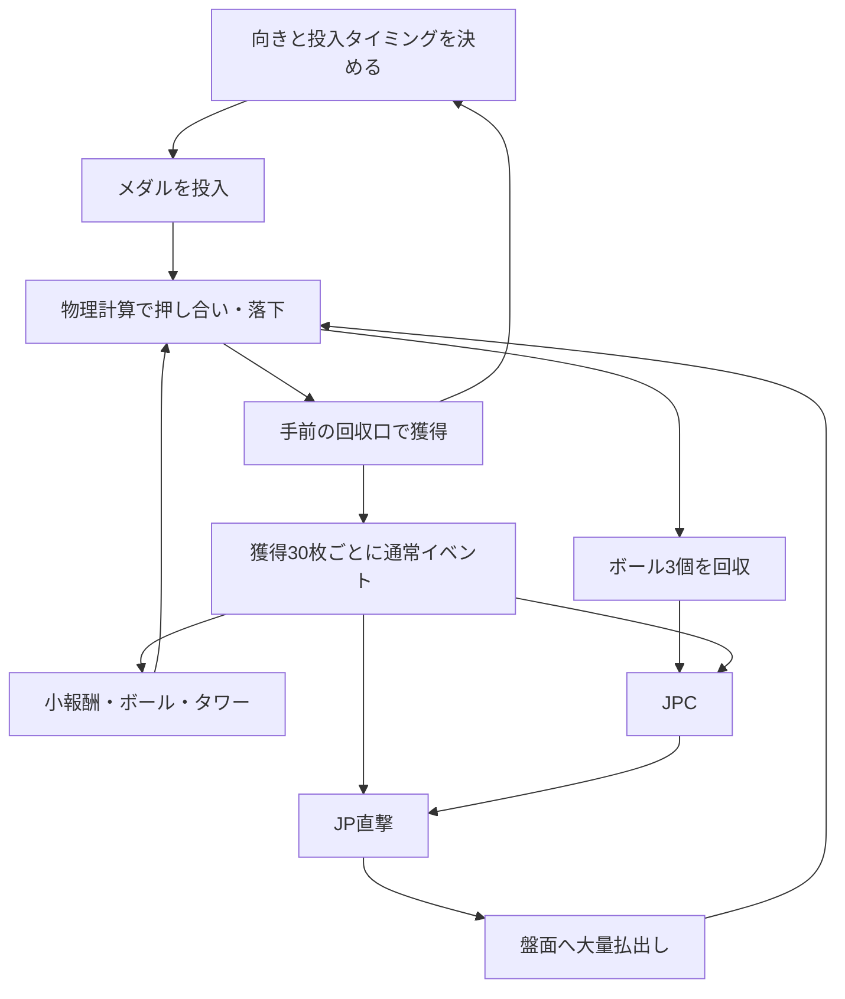

# coin ゲーム設計書

- バージョン：0.1（企画・技術検証用）
- 作成日：2026-10-15
- 対象リポジトリ：hellowinners861/coin
- 状態：設計段階。ゲーム本体・性能・物理挙動は未実装／未検証。
- 数値の扱い：本文の確率、必要枚数、寸法、性能目標は、明記した実機情報を除き本作独自の仮設定。実機の内部抽選値を再現するものではない。

## 1. 目的と決定状況

左右に向きを振れる投入口からメダルを落とし、前後する押し台で盤面のメダルを押し出す3Dメダルプッシャーを作る。狙いと投入タイミング、ボールの回収、イベント、コインタワーの崩壊が次の遊びにつながる構成にする。

最優先の体験は、投入した1枚が周囲のメダルへ力を伝え、重なりや支えが変化し、最後に大量のメダルが自然に落ちること。盤面を観察して狙う意味を持たせる。

### 1.1 ユーザー要望として確定した方向性

| ID | 要件 |
| --- | --- |
| R1 | 投入口の向きを左右に振ってメダルを投入する。 |
| R2 | 盤面へボールがランダムに追加される。 |
| R3 | 一定枚数のメダル獲得を契機にイベントが始まる。 |
| R4 | イベントの結果として、10枚などのメダル報酬、ボール追加、ジャックポットにつながる報酬がある。 |
| R5 | コインタワーが一定確率で設置され、投入を工夫して崩せる。 |
| R6 | メダル・ボール・タワーの挙動をできる限り3D物理計算で決める。 |
| R7 | イベントのテーマ、キャラクター、競技・物語・演出はユーザーと相談して決める。 |
| R8 | 実機の公式情報と攻略記事を調べ、参考にした仕組みと本作の提案を区別する。 |

### 1.2 本書で提案する初期仕様

- スマートフォン縦画面を主対象とし、PCブラウザでも遊べる1人用・1台構成。
- 通常の獲得メダル30枚ごとにイベントを1件発生させる。
- 手持ちから投入したメダル5枚ごとに、20%でボール追加を抽選する。
- ボール3個の回収でジャックポットチャレンジ（以下JPC）を獲得する。
- 通常イベントから小報酬、ボール、タワー、JPC、低確率のジャックポット直撃へ分岐する。
- 初期ジャックポット（以下JP）は盤面への300枚払出し。固定額で始め、蓄積型JPは後の検討対象とする。
- 物理エンジンの第一候補をRapier 3D、描画の第一候補をThree.jsとする。採用確定は物理試作とスマートフォン実測後。

### 1.3 相談して決める内容

イベントにポケモン、野球、動物などを現時点で割り当てない。これらはユーザーが挙げた方向性の例であり、本作の採用テーマではない。試作では「イベント」「ボール」「タワー」「JPC」という中立的な表示を使う。

正式タイトル、世界観、イベント中の操作、成功／失敗の見せ方、キャラクター、音楽、JP演出、収集要素は未決定。確率や物理調整の検証と、テーマ選定を並行して進められる設計にする。

## 2. 実機・攻略記事の調査

調査日：2026-10-15。下記は公開資料から確認できた範囲の要約。公式資料をルール確認に使い、攻略記事はプレイヤーが何を観察・目標にするかの参考に使う。攻略記事にある体感、内部状態の推測、必勝表現を確定仕様として採用しない。

### 2.1 参考機種と本作への取り込み方

| 機種・資料 | 確認できた仕組み | 本作への設計上の提案 |
| --- | --- | --- |
| バベルのメダルタワーW！／セガ公式 [S1] | オーブ3個の落下でサテライトチャレンジへ進む。JPでタワーが払い出され、タワーの移動を補助するガイドを備える。 | ボール回収を中期目標にする。タワーを「盤面に残る、狙って崩す報酬」にする。 |
| パワフルプロ野球 開幕メダルシリーズ！／KONAMI公式 [S2] | プッシャーと野球の試合を組み合わせ、タイミングを合わせるバッティングを物理抽選として扱う。 | 盤面の遊びとイベントの遊びを接続する。テーマを後から交換できる構造にする。 |
| 同機種の攻略記事 [S3] | フィールドのボールを落とすとバッティングへ進む流れ、ボールの位置やボーナスまでの進行に着目している。 | ボール位置、次のイベントまでの枚数、収集状況を読み取れるUIにする。 |
| バベルWの攻略記事 [S4] | ボールの収集状況、タワーに関わる蓄積、タワーを押すための投入量などを判断材料としている。 | 目標の進行を見えるようにし、タワーまでの距離や周囲のメダル配置に狙いを作る。 |
| ポケモンコロガリーナ／セガ公式 [S5] | スゴロクによる進行、物理ボールを使った獲得・バトル・ボーナスがある。 | 周辺ジャンルのイベント構成例。収集から次のイベントへ進む段階構造を参考にする。 |

ポケモンコロガリーナは、公式説明上、スゴロクと物理ボール抽選を中心とする。本作と同じ投下型プッシャーの盤面を持つ例としては扱わない。ユーザーが思い浮かべたポケモン機種を特定したものでもない。

バベルは初代とWで進行条件が異なる。初代のオーブ10個と、Wの3個からサテライトチャレンジへ進む条件を混ぜない [S1]。パワプロの攻略記事も機種更新時期によって内容が変わるため、旧版のラウンド数や詳細な報酬値を本作の根拠にしない。

### 2.2 調査を踏まえた独自設計

本作は、短期の「メダル獲得→通常イベント」、中期の「ボール回収→JPC」、盤面上の大目標である「タワー崩壊」を並行させる。30枚、20%、300枚などの数値は本作の提案であり、参考機種の数値から推定したものではない。

## 3. 基本のプレイループ

図の分岐は当選した結果に従う。JPCが必ずJPになるわけではない。ボール・タワーの出現確率はゲームルールで決め、出現後の動きや落下は物理計算で決める。

## 4. 盤面・操作・ゲーム開始

### 4.1 盤面の構造

| 部位 | 役割 |
| --- | --- |
| 首振り投入口 | 中央付近に支点を持ち、左右の角度を変えるレール。投入位置の横移動とは区別する。 |
| 上段の可動台 | 前後に往復し、投入メダルを受け止める。 |
| 固定の背板・上段縁 | 可動台との相対運動でメダルが堆積し、前縁から下段へ落ちる構造を試作する。 |
| 下段の固定台 | メダル、ボール、タワーが滞留する主な攻略領域。可動台の前面で下段のメダルを押す。 |
| 手前の回収口 | メダル獲得とボール回収を判定する。 |
| 左右の落下溝 | メダルの横落ちを受ける。横落ちはメダル獲得に含めない。 |
| ボール供給口 | 球を盤面後方へ供給する独立したレール。 |
| メダル払出し口 | 通常報酬やJPのメダルを分割して盤面へ供給する。 |
| タワー搬入部 | 盤面外で組んだタワーを、搬送台とガイドで下段へ送り込む。 |

押し台と固定床の隙間、段差、縁の厚みも当たり判定を持つ。描画上の縁だけでメダルが落ちる場所を決めない。盤面の初期寸法はメダル直径Dを基準に幅12D、奥行き16D、押し台ストローク1.2D程度とし、断面形状と一緒に検証する。

上段に置いたメダルが下段へ自然に移ること、下段で力が手前へ伝わることを最初の試作で確認する。往復板を置いただけでメダルが前進するとは仮定しない。

### 4.2 操作

- 左右ドラッグまたは画面下部の角度操作で、投入口を左右35度まで振る。
- 投入ボタン1回で1枚。長押しは毎秒3枚を仮設定とする。
- 角度操作と投入は同時に使える。タッチキャンセル、画面外への指移動、アプリ切替時に長押しを解除する。
- PCではドラッグ／左右キーと投入ボタン／スペースキーを用意する。
- 投入する角度・初速・姿勢を物理ステップに同期して確定する。落下先を後から書き換えない。
- 自由なカメラ回転は初版に入れず、手前斜め上から盤面を読み取れる固定視点にする。

### 4.3 開始・再挑戦

初期手持ちは100枚、初期盤面は事前に安定化した150枚程度、ボール1個、タワーなしとする。初期のメダルは端に少し山があり、投入による変化を観察しやすい配置にする。

時間制限は設けない。手持ち0枚でも、落下待ち、獲得済みイベント、未処理の報酬は継続する。「はじめから」で初期状態へ戻せる。初期配置・初期ボールは獲得やボール回収として数えない。開始後に実際に落ちた分から計上する。

## 5. メダルの獲得・報酬の定義

「画面に表示された当選枚数」「盤面に払い出した枚数」「手元に増えた枚数」を混同しない。

| 種類 | 処理 | 手持ち残高 | 通常イベントの獲得ゲージ |
| --- | --- | --- | --- |
| プレイヤー投入 | 手持ちから1枚を盤面へ投入 | -1 | 増えない |
| 手前でメダル回収 | 実物のメダル1枚が回収センサーへ到達 | +1 | +1 |
| 横落ち | メダルを回収・消去 | 変化なし | 増えない |
| CREDIT(10) | 報酬として手持ちへ10枚を直接加算 | +10 | 増えない |
| FIELD_PAYOUT(n) | n枚を実物として盤面へ順次供給 | この時点では増えない | この時点では増えない |
| ボール追加・タワー設置 | 物理オブジェクトを供給 | この時点では増えない | この時点では増えない |

FIELD_PAYOUTやタワーのメダルも、後で手前へ落ちた時点で通常の獲得となり、ゲージを進める。これにより大量払出しから次のイベントへの連鎖が起こる。直接加算をゲージに含めない理由は、報酬の受け取りだけで同じイベントが自動再発火する循環を防ぐため。

画面では「手持ち +10枚」「盤面へ300枚払出し」「実際の獲得 +42枚」のように表示を分ける。JPの300枚がそのまま全額手持ちに入る意味ではない。

各メダルに一意なIDを割り当て、回収判定は1回だけ確定する。手前・横・異常落下のセンサー領域を分離し、回収が確定したメダルが別の領域で重複加算されないようにする。

## 6. 獲得枚数で始まる通常イベント

### 6.1 発生条件

手前での物理的なメダル獲得を累積し、30枚ごとにイベント権を1件発行する。余りは繰り越す。

例：ゲージ24枚の時に71枚獲得した場合、合計95枚となる。イベントを3件発行し、ゲージは5枚にする。イベント中の獲得も同じように積算する。

実装は「ゲージを30で割った整数部分だけ発行し、余りを保存する」。1フレームに大量落下しても1件に丸めない。投入枚数や手持ち残高を、このゲージの代わりに使わない。

### 6.2 初期抽選テーブル（本作独自の仮設定）

| 結果ID | 確率 | 報酬・動作 |
| --- | ---: | --- |
| NONE | 40% | 今回の報酬なし。短い結果表示で終了。 |
| CREDIT_10 | 35% | 手持ちへ10枚を直接加算。 |
| BALL_1 | 18% | 盤面にボール1個を追加する権利を発行。 |
| TOWER_STANDARD | 4% | 標準タワー1基を設置する権利を発行。 |
| JPC_ENTRY | 2% | JPCを1件発行。 |
| JACKPOT_DIRECT | 1% | JPCを経由せずJPに当選。 |
| 合計 | 100% | 1回につき1つの結果。 |

これらは完成版の確率ではない。イベントの頻度、初期100枚での遊べる長さ、タワーやJPの体験頻度を測定して変更する。見せ方やキャラクターを決める前でも抽選と報酬処理は検証できる。

### 6.3 イベントと物理進行

- 通常イベントの表示は3〜5秒程度の小さな演出枠を想定し、盤面の物理計算と通常投入は継続する。
- 演出は1件ずつ表示する。複数の権利はFIFOで保留し、保留件数を表示する。
- 抽選結果は演出開始時に一度だけ確定し、保存する。スキップや再読み込みで再抽選しない。
- 演出スキップは待ち時間だけを短くし、報酬内容は変えない。
- イベントの完了は「報酬権利を永続化した時点」でよい。実物を置けるまで演出キューを占有し続けない。
- ボール上限やタワーの設置待ちは、別の報酬供給キューで処理する。報酬を捨てたり、勝手に別の報酬へ交換しない。
- メダル払出し、ボール、タワーは種類ごとの待ち行列を持つ。タワーの搬入待ちが、手持ち加算やJPCの発行、他の供給口を停止させない。共有する物体枠だけを供給管理側で調整する。
- 一括スキップを設ける場合も、内部では各イベントIDの抽選・確定・付与を個別に処理する。

### 6.4 テーマを後から決めるための境界

通常イベントは、発生条件、抽選、見た目、報酬適用を別々に扱う。初版は「重み付き抽選＋中立的な結果表示」で動作させる。

将来の候補には、スポーツの勝負、動物の探索、キャラクター収集、冒険のマップ進行などがある。採用はユーザーとの相談後に決める。

操作で結果を変えられるイベントを採用する場合は、入力判定・成功率・報酬テーブルの仕様を追加する。既に決まった抽選結果に対して、操作で結果が変わるような見せ方はしない。純粋な抽選か、実際の技能判定かを仕様上区別する。

## 7. ランダムボール

### 7.1 追加条件

- 手持ちを1枚消費して投入を成立させた回数を数える。
- 確定投入5枚ごとに、20%でボール1個の追加を抽選する。
- JPや通常払出しによる供給メダルは、この投入回数には含めない。
- フレームごと・毎秒の抽選にはしない。放置時間や端末のFPSで追加頻度を変えない。
- 上限にかからない場合の平均は投入25枚に1個。ただし確率なので保証ではない。
- 盤面のボールは最大3個。自発追加は「盤面上＋未供給の確定ボール権利」が3個以上なら抽選を行わず、その機会を繰り越さない。
- イベントで当選したボールは上限中でも権利を保存し、空きができてから順番に供給する。

自発追加の上限判定、抽選、当選権利の予約は同一トランザクションで処理し、同時追加で上限を超えないようにする。

### 7.2 物理挙動と回収

ボールは球形の動的剛体とし、専用レールから後方へ落とす。コインの上を転がり、積み重なりを押し分け、手前へ運ばれる。メダルとボールは相互に力を受ける。

ボール直径はメダルの約2.2倍、質量はメダルの約2〜3倍を試作候補とする。形状と質量の最終値は、転がりやすさ、メダルを押し過ぎないこと、画面上の見やすさから決める。

手前のボール回収は1個につき1ステップ。3ステップでJPCを1件発行し、余りを保存する。ボール自身をメダル1枚として残高や通常イベントゲージへ加算しない。

横落ちしにくい球ガイドを形状として設ける。側方の回収経路へ入った球はステップを与えず、回収完了後に同じ球の再供給権利へ変換する。元の剛体を消した後でのみ再供給し、複製を防ぐ。再供給によって自発追加の抽選は行わない。

## 8. JPCとジャックポット

### 8.1 JPCへの入口

- ボール回収3個。
- 通常イベントのJPC_ENTRY。

どちらもJPCを1件発行する。通常イベントからJPCへ直接進んでも、途中まで集めたボールステップは失わない。JP直撃も既存のステップ・保留権利を消費しない。

### 8.2 JPCの試作結果

| 結果ID | 確率 | 処理 |
| --- | ---: | --- |
| CREDIT_10 | 70% | 手持ちへ10枚を加算。 |
| FIELD_30 | 20% | 盤面へ30枚を払い出す。 |
| JACKPOT | 10% | 盤面へ300枚を払い出すJPに当選。 |
| 合計 | 100% | テーマと最終確率は今後調整。 |

JPCの具体的な遊び・画面は未決定。物理抽選機を採用する場合は、抽選球の運動と入賞穴で結果を確定する方式を別途試作する。その場合、この固定確率テーブルは参考目標となり、実際の穴の大きさだけで厳密に10%になるとは仮定しない。物理抽選の結果を裏で差し替えない。

### 8.3 JP払出し

JP当選時点で300枚の払出し権利を確定する。全枚数を同じ位置に一度に生成せず、専用供給口から毎秒10〜15枚程度を初期候補として順次投入する。落下してきたメダルは通常のメダルと同じ物理特性を持つ。

払出し量と処理済み量を保存し、中断後も残りから再開する。複数のJPはそれぞれの権利を保存して順番に供給する。同時に複数の大量払出しを走らせない。

JP中の実際の獲得は通常イベントゲージに加算する。次のイベントが連鎖しても取りこぼさず保留する。払出し中も盤面を見て投入でき、メダルの山やタワーを押す機会にする。

## 9. コインタワー

### 9.1 発生・報酬としての意味

通常イベントの4%で設置権利を得る。標準タワーは120枚を試作値とする。タワーが建っただけでは手持ちは増えず、崩れたメダルが手前へ落ちた時点で獲得になる。

当面、同時に構造を保ったタワーは1基までとする。追加当選は「次のタワー」として保留する。崩れた後のメダルは通常メダルとして残し、表示や計算負荷の都合で消さない。

### 9.2 組み立てと搬入

1. 盤面外の搬送台に、120個の独立したコイン剛体を、互いに重ならない配置で用意する。
2. 形状候補は1層3枚×40層の交互配置。高さ・支持の安定性を検証して配列を決める。枚数だけを先に固定し、見た目の高さを無理に作らない。
3. 実際に当たり判定を持つ側面ガイド・搬送台で支え、安定させる。各メダルは動的剛体として扱う。
4. 下段後方の搬入位置に空きがあることを確認し、搬送台をキネマティックに動かしてゆっくり供給する。
5. 盤面へ受け渡した後、ガイドを物理的に退避させる。支持を失った物体は覚醒させる。

設置場所に既存メダルやボールがある場合は待機する。既存物体を削除したり、タワーを重ねて瞬間生成したりしない。搬入口・ガイドの位置は盤面試作時に確保し、押し台の往復領域と衝突しないようにする。

### 9.3 崩れ方

タワーの重心、支持、コイン間の摩擦、接触、回転、重力で崩れる。1つの巨大剛体や、一定の投入枚数で壊れるHPとしては扱わない。倒れる直前に個別メダルへ置き換える方式も採用しない。

攻略は「土台付近へ力を伝える」「左右の支持を偏らせる」「手前へ押し出して支えを減らす」ことから自然に生まれるようにする。崩壊の保証や投入枚数による強制崩壊は設けず、狙いによって進展が見える配置・摩擦・縁の設計を検証する。

タワーの状態は queued → assembling → transferring → standing → collapsing → dispersed として記録する。崩壊判定は演出と次の設置可否のためにのみ使い、コインの力学を変更しない。立った構造が失われ、搬入域が空いたら次のタワーを搬入できる。既存の散ったメダルも物体数に含める。

## 10. 物理計算の設計

### 10.1 基本方針

全メダルを厚みのある3D剛体として計算する。実際の薄い円柱の接触を近似するため、円柱またはごく小さく角を丸めた円柱を候補とする。Rapierには円柱・丸めた形状があり、動的物体に複雑な三角形メッシュをそのまま使うことは推奨されていない [S6]。

描画メッシュと衝突形状は別にするが、外径・厚み・縁が見た目と一致するようにする。丸め半径の分だけ外形が増える点を考慮し、重なって見える状態や隙間を過剰に作らない。

| 対象 | 物理表現 |
| --- | --- |
| メダル | 動的剛体1個＋円柱系コライダー1個。各軸の回転を許可する。 |
| ボール | 動的剛体＋球形コライダー。 |
| タワー | メダルごとの独立剛体。固定ジョイントで接着しない。 |
| 押し台・搬送台 | 速度が計算されるキネマティック剛体。 |
| 床・壁・ガイド | 単純形状を組み合わせた固定またはキネマティックなコライダー。 |
| 回収口 | 衝突を妨げないセンサーと、そこまで導く実際の床・壁。 |

押し台は次のキネマティック位置を与えて滑らかに動かす。可動台の上のコインを座標加算で一緒に動かさず、接触と摩擦で運ぶ。急な位置飛びによってコインを押し潰さない [S7]。

### 10.2 時間刻み・衝突精度

- 物理計算は固定刻み1/120秒を第一候補とし、描画の30／60fpsと分離する。
- 描画は前後の物理状態を補間する。通常の描画フレーム差で押し台の速度や投入数を変えない。
- ソルバー反復は8程度を開始候補とし、密集・積層の検証で増減する。追加反復は接触でつながった領域全体へ影響し得るため、タワーだけに無料で追加できるとは見なさない [S9][S10]。
- 投下中・高速移動中のメダルとボールにCCDを使う。CCDだけで薄い物体同士のすり抜けが完全になくなるとは仮定せず、刻み幅、相対速度、形状、反復数を組み合わせて検証する [S7]。
- 処理落ち時に巨大な可変dtを渡さない。追いつき処理の上限を設け、必要ならゲーム全体の進行を一時的に遅らせる。物理時間・押し台・投入・演出の整合を保つ。
- バックグラウンド移行時は停止・保存し、復帰時に経過時間を一気に物理計算へ流し込まない。

### 10.3 寸法・材質の試作値

下記は実測した実機の値ではなく、シミュレーションの開始条件。

| 項目 | 仮設定 |
| --- | --- |
| 座標・質量・時間 | メートル・kg・秒に統一 |
| 重力 | 9.81 m/s² |
| メダル直径 | 0.025 m |
| メダル厚み | 0.0018 m |
| メダル質量 | 0.005 kg |
| メダルの摩擦係数 | 0.45 |
| 台の摩擦係数 | 0.35 |
| 摩擦の合成 | Averageで開始。コイン同士0.45、コインと台0.40になる。 |
| メダルの反発係数 | 0.05程度 |
| ボール直径 | 0.055 m |
| ボール質量 | 0.012 kg |
| 押し台の往復周期 | 3.0秒 |
| 押し台のストローク | 0.030 m |

小さいコインの厚みに対して、接触許容誤差や予測距離が大き過ぎないように調整する。静止積層時の貫通量は厚みの5%程度以下を暫定目標とし、下から浮き上がるような過大な接触マージンも避ける。Rapierの単位・許容値を確認し、単位を変える場合は重力、寸法、接触閾値を一貫して変換する [S9]。

Rapierの標準摩擦は静摩擦と動摩擦を別係数として扱わないという制約がある [S8]。「実機を完全再現」とはしない。まず有効摩擦係数を調整し、滑り出しと滑走の差が体験を損なう場合に接触処理の拡張や別エンジンを比較する。

金属の微細な変形、傷、表面粗さ、コインの反りまで再現する仕様にはしない。厚み、慣性、重心、摩擦、反発、接触を優先する。過剰な減衰でタワーを不自然に固定しない。

### 10.4 物理挙動と抽選の独立性

抽選は「何を出すか」を決める。物理計算は「出した物がどこへ動き、何枚落ちるか」を決める。残高、直前の当選、期待払出し率に応じて、プレイ中の摩擦・重力・衝突・コイン位置を隠れて変えない。

投入時の小さなばらつきを使う場合は、一定範囲の初期姿勢・速度として与え、設定と乱数状態を保存する。落下途中に獲得へ誘導する力や、タワー崩壊を起こす見えない力は加えない。

### 10.5 性能と品質の優先順位

通常150〜300枚、標準タワー120枚、JP払出し300枚が同時に関係する場面を検証する。初期のメダル剛体上限候補は900枚。これは達成済みの性能ではない。

最適化は、描画のインスタンシング、影・解像度・反射の調整、静止剛体のスリープ、回収済み剛体の解放、供給の分割の順で検討する。Three.jsのInstancedMeshは同形状の描画をまとめる手段であり、物理の剛体数を減らすものではない [S11]。スリープ中でも支えの変化や接触で覚醒できるようにする [S7]。

上限に達したら未供給の報酬を保留し、コインが回収されて枠が空いたら供給する。タワー搬入前には必要枚数分を予約する。投入が物理的に生成できない時は手持ちを減らさず、待機を表示する。見えているコインの削除やタワーの一体化で上限を回避しない。

低性能端末ではまず描画を30fpsに落とす。物理設定を変える低負荷モードが必要なら、別プロファイルとして検証し、途中で密かに変更しない。初期対応の目標端末はiPhone 17 ProのSafari、比較対象は中位AndroidとPC。タワー崩壊を含む性能は実機計測で確定する。

## 11. 画面・演出

| 領域 | 表示・役割 |
| --- | --- |
| 上部 | 手持ち枚数、通常イベントまでの残り枚数、ボール回収0〜2/3、イベント保留件数。 |
| 中央 | 盤面を最も大きく表示。タワーの根元、手前の縁、球の位置が見える。 |
| 小さな演出領域 | 通常イベントとJPC。盤面全体を長時間隠さない。 |
| 下部 | 投入口の角度操作、投入ボタン。片手でも操作しやすい大きさ。 |
| 報酬表示 | 手持ち加算、盤面払出し残り、ボール／タワーの設置待ちを区別。 |

コイン衝突音は衝突の強さと同時発音上限で管理し、大量落下で音が飽和しないようにする。通常獲得、大量獲得、ボール回収、タワー崩壊、JPを音で区別する。画面振動は弱くし、無効化できるようにする。

見た目は金属の厚みと縁を読み取れるものにする。装飾で手前の落下境界を隠さない。音量、振動、演出スキップ、描画品質を設定できるようにする。テーマの画像・キャラクター・楽曲は今後の相談で決める。

## 12. 実装構成案

初期案はTypeScript、Three.js、Rapier 3D、ブラウザ内の永続保存。バージョンは実装開始時に確認して固定する。クライアントだけで遊べる構成から始め、ランキングやアカウント同期は別段階で検討する。

| モジュール | 責務 |
| --- | --- |
| GameLoop | 固定物理ステップ、描画補間、一時停止、復帰。 |
| MachineGeometry | 台、縁、レール、回収口、搬入機構の寸法と当たり判定。 |
| PhysicsWorld | 剛体、材質、接触、CCD、スリープ。 |
| InputController | 首振り、単発投入、長押し、PC入力。 |
| CoinSpawner / BallSpawner | 重複のないID、初期状態、供給位置、容量予約。 |
| CollectionSystem | 手前／横／球回収の確定、重複防止。 |
| Economy | 手持ち、投入、物理獲得、直接報酬、集計。 |
| EventDirector | 獲得ゲージ、イベント保留、抽選結果の確定。 |
| RewardDispatcher | 手持ち加算、物理払出し、球・タワー・JPCの権利処理。 |
| TowerSystem | 組立、搬入、構造状態の観察、次の設置可否。 |
| ThemeAdapter | イベントの名称、描画、音、演出。ルールの状態を読み取る。 |
| SaveSystem | 整合したスナップショット、版管理、再開。 |
| Diagnostics | FPS、物理処理時間、剛体数、衝突異常、確率・経済の検証用記録。 |

ThemeAdapterはイベント結果を描画し、演出完了や入力を返す。残高を直接変更しない。報酬はRewardDispatcherだけが適用する。テーマの差し替えでコインの物理や残高処理が変わらないようにする。

### 12.1 主なデータ

- Coin：id、source、bodyHandle、回収状態。sourceはinitial／player／fieldReward／jackpot／towerを区別。
- Ball：id、source、bodyHandle、回収または再供給状態。
- EventTicket：eventId、発生理由、設定バージョン、確定結果、表示状態、報酬ID。
- RewardJob：rewardId、種別、総量、予約量、生成済み量、残量、処理状態。
- Tower：towerId、メダルID一覧、搬送状態、構造状態。
- Progress：イベントゲージ余り、ボールステップ余り、確定投入の余り、各保留キュー。
- Economy：wallet、totalPaidIn、totalPhysicalWon、totalDirectCredit、totalSideLost。

sourceは検証と集計に使う。同じメダル形状であれば、sourceによって摩擦や落ちやすさを変えない。

### 12.2 乱数と実行順

通常イベント、ランダムボール、JPC、投入ばらつき、装飾演出の乱数系列を分離する。コインの衝突回数や描画フレーム数がイベント確率を変えないようにする。開発時はシードと入力列を記録できるようにする。

各ステップは、入力受付 → 物理計算 → 回収確定 → 残高とゲージ更新 → 権利発行 → 報酬ジョブ更新 → 描画用状態更新、の順にする。物理エンジンの衝突コールバック中に剛体を削除・大量生成せず、ステップ境界で適用する [S12]。

同一エンジン版・設定での再現性を検証用の目標とする。異なる端末・エンジン版で、微小な積層挙動までビット単位に一致するとは保証しない。

## 13. 保存・再開・障害時の扱い

保存対象は、残高、累計、各ゲージ、乱数状態、確定済みイベント、報酬残量、全メダルとボールの位置・姿勢・速度、押し台の位相、タワー搬送状態、設定／保存形式／エンジンのバージョンとする。

IndexedDBを第一候補とし、整合したゲーム状態と物理状態を同一スナップショットにまとめる。初期実装では数秒間隔の保存と、抽選確定・報酬確定・一時停止などの節目の保存を組み合わせる。終了通知だけに依存しない。

- アプリ終了時の最後の保存が成功しない場合は、最後に正常保存された状態から再開する。
- 中途半端な残高だけを復旧せず、物理盤面と報酬キューを同じ時点へ戻す。
- 報酬IDごとに適用状態を管理し、再開やスキップで同じ10枚を二度加算しない。
- JPは残り払出し枚数から再開する。既に盤面にあるメダルをもう一度供給しない。
- 保存形式の非互換や破損時は旧データを保持し、説明して再挑戦を選べるようにする。黙って盤面を作り直さない。
- ローカル保存の初版は対戦用の改ざん防止や厳密なランキング検証を目的にしない。

盤面外へ抜けた物体などの異常は検証ログに記録する。正規の手前回収を通っていないメダルを自動獲得にしない。試作時の物理異常は再現・修正し、ゲームルールで常時補正する設計にしない。

## 14. 調整項目と検証

### 14.1 経済・テンポの調整

実機の内部ペイアウト率は推定しない。本作の手持ち増減、イベント間隔、球の流れ、JP後の連鎖を独立して測る。

| 指標 | 確認する目的 |
| --- | --- |
| 投入枚数／物理獲得枚数／直接加算枚数 | 払出しと実際の利益を区別する。 |
| 初期100枚からの継続時間 | 最初の体験が短過ぎないか。 |
| 30枚獲得までの所要時間 | 通常イベントの待ち時間。 |
| ボール追加から回収までの時間 | 球が停滞せず目標になるか。 |
| タワー搬入から崩壊までの投入数と分布 | 狙う余地と負担の両方を把握する。 |
| 報酬キューの最大長・滞留時間 | 大量当選で進行が詰まらないか。 |
| 通常／球／JPを含む連鎖イベント数 | 報酬連鎖が過剰に長引かないか。 |

抽選テーブルの単体検証と、物理を含む試遊を分ける。数値だけで無限に報酬が自己増殖しないかを確認し、連鎖が長い場合は設定を調整する。プレイ中に当選を取り消すことで調整しない。

タワーの狙い撃ちと無作為投入を、同じ初期配置・同じ投入枚数・複数の条件で比較する。狙って投入しても何も変わらない場合は、搬入位置、押し台、摩擦、床形状を見直す。

### 14.2 物理・性能の合格条件案

以下は実装時の検証項目であり、現時点で合格を確認した結果ではない。

| ケース | 合格条件案 |
| --- | --- |
| 1枚の落下・転倒・縁からの落下 | 見た目と衝突境界が一致し、厚みと回転が表現される。 |
| コインの静止積層 | 振動し続けない。過大な沈み込みや浮きがない。 |
| 押し台の往復 | メダルが物理接触で運ばれ、途中で貫通・瞬間移動しない。 |
| 密集したコイン同士 | 局所の押す力が周囲へ伝わり、不自然に爆発しない。 |
| ボールとメダルの混在 | 相互に押し合い、コインをすり抜けない。 |
| タワー120枚の搬入 | 独立剛体のまま受け渡せる。既存物体を消さない。 |
| タワーの崩壊 | 基部の支持変化から傾き・分離・落下が生じる。 |
| JP300枚の払出し | 枚数を維持して供給し、重なった位置に大量生成しない。 |
| 900枚近い上限状態 | 物体を消さず供給待ちへ移り、空きができれば再開する。 |
| 通常盤面とタワー＋JP | 対象スマホで60fpsを目標、重い場面でも30fps以上を目標として計測する。 |
| 30／60fps描画と復帰 | 同じ物理刻みで進み、ゲーム速度や投入数が変わらない。 |
| 連続プレイ | 10分程度で剛体・GPUメモリ・イベント保留が不当に増え続けない。 |

FPSだけでなく、物理1ステップと描画の処理時間、最大負荷時の遅延を記録する。基本物理が成立しない場合はテーマ制作を先行させず、盤面・物理エンジン選定へ戻る。

### 14.3 ルールの受け入れ例

1. ゲージ24枚＋物理獲得71枚で、イベント3件・余り5枚となる。
2. CREDIT(10)は残高だけを10増やし、通常イベントのゲージを増やさない。
3. JP300枚は300枚の供給権利であり、残高へ即時300枚を加算しない。
4. 同じコインの回収通知が複数回来ても、残高とゲージの増加は1回だけ。
5. ボール回収の余り2個から2個回収すると、JPC1件・余り1個となる。
6. 手持ちからの確定投入10枚で自発ボール追加の抽選機会が2回。払出し10枚では0回。
7. ボール上限中にイベントで当選した1個は、空きができたら1回だけ追加される。
8. タワー設置待ちに追加当選しても、確定した設置権利が失われない。
9. 残り200枚のJP払出しを保存・再開しても、供給総数は300枚で一致する。
10. イベント結果を保存後に再開しても、再抽選と二重報酬が発生しない。

## 15. 実装順序

| 段階 | 作るもの | 完了の判断 |
| --- | --- | --- |
| P0：物理試作 | 1枚、積層、可動台、下段、ボール、小規模タワー。 | 薄い円柱の接触と盤面の力の伝達が成立する。 |
| P1：基本ゲーム | 首振り、投入、初期盤面、獲得、横落ち、残高、再挑戦。 | 単体のプッシャーとして遊べる。 |
| P2：イベント基盤 | 獲得ゲージ、乱数、通常イベント、直接加算、保留、ランダムボール。 | 中立的な仮表示で全報酬経路が確認できる。 |
| P3：大きな目標 | ボール回収、JPC、JP払出し、120枚タワーの搬入と崩壊。 | 各経路がつながり、負荷と報酬の整合が保てる。 |
| P4：保存と実機調整 | 中断再開、物理／描画最適化、テンポ調整。 | スマホで継続プレイでき、報酬の消失・重複がない。 |
| P5：相談してテーマ制作 | 世界観、イベントの具体的内容、画像・音・収集演出。 | ユーザーと合意したテーマで体験が統合される。 |

保存用IDや状態分離はP1から設計し、P4で永続化を完成させる。テーマの相談はP0以降いつでも進められる。イベントへ技能操作を追加する決定があれば、P2の結果判定仕様を更新する。

## 16. 次に相談する論点

- イベントを「短い運の抽選」「操作を伴うミニゲーム」「収集やマップ進行」のどれに寄せるか。
- 世界観を動物、スポーツ、冒険、その他のどれにするか。特定作品を採用するかは未決定。
- JPを大量のメダルシャワー中心にするか、巨大タワーや特別な盤面変化も加えるか。
- 通常タワーの大きさと出現頻度を、試遊結果からどの程度にするか。
- 先の暫定値から変える場合、最初の手持ち枚数、イベント間隔、ボール頻度をどうするか。

これらが未決定でも、P0〜P3の物理と共通ルールの試作は進められる。決定事項は本書の更新履歴へ追加し、仮設定と合意済み仕様を区別し続ける。

## 17. 参照資料

すべて2026-10-15に参照。公開ページの要点を短く要約しており、本文・画像を転載していない。

### 実機の公式情報

- **[S1] セガ：バベルのメダルタワーW！ 製品紹介** — https://www.sega.jp/arcade/detail/babeltower-w/  
  確認対象：タワー払出し、タワーガイド、初代とWのオーブ条件の違い。
- **[S2] KONAMI：パワフルプロ野球 開幕メダルシリーズ！ 稼働開始案内（2024-07-08）** — https://www.konami.com/amusement/corporate/ja/topics/20240708/  
  確認対象：プッシャーと試合の接続、タイミングを使う物理バッティング抽選。
- **[S5] セガ：ポケモンコロガリーナ 遊び方** — https://corogarena.sega.jp/guide/index.html  
  確認対象：スゴロク、ボールによる獲得、収集からバトル・ボーナスへの進行。周辺ジャンルの参考。

### 攻略記事・プレイヤー視点

- **[S3] メダルゲーム攻略ラボ：パワフルプロ野球 開幕メダルシリーズ！の遊び方・コツ** — https://cocoaore.jp/medalgame/pawapuro/  
  確認対象：ボール回収からバッティング、盤面上のボール位置と進行への着目。細部は掲載時の版に依存。
- **[S4] メダルゲームは運ゲーじゃない！見極めゲーだ！！：バベルのメダルタワーW 攻略** — https://medalgame.net/babeltower-w  
  確認対象：収集状態やタワーに関するプレイヤーの判断材料。記事の体感・内部確率の推測は仕様の根拠にしない。

### 技術の一次資料

- **[S6] Rapier：Colliders** — https://rapier.rs/docs/user_guides/javascript/colliders/  
  確認対象：円柱系形状、丸め形状、動的三角形メッシュの制約。
- **[S7] Rapier：Rigid-bodies** — https://rapier.rs/docs/user_guides/javascript/rigid_bodies/  
  確認対象：剛体種別、キネマティック移動、CCDの範囲と制約、スリープと覚醒。
- **[S8] Rapier：Collider friction** — https://rapier.rs/docs/user_guides/javascript/collider_friction/  
  確認対象：摩擦係数の合成、静摩擦・動摩擦を別係数にしない標準モデル。
- **[S9] Rapier：Integration parameters** — https://rapier.rs/docs/user_guides/javascript/integration_parameters/  
  確認対象：固定刻み、単位、反復、精度と負荷の調整。
- **[S10] Rapier：Rigid-body solver settings** — https://rapier.rs/docs/user_guides/javascript/rigid_body_solver_settings/  
  確認対象：追加反復が接触でつながる領域に及ぶこと。
- **[S11] Three.js：InstancedMesh** — https://threejs.org/docs/pages/InstancedMesh.html  
  確認対象：同形状をまとめる描画方式。
- **[S12] Rapier：Simulation structures** — https://rapier.rs/docs/user_guides/javascript/simulation_structures/  
  確認対象：物理ワールド、ステップ、接触・センサーイベント。具体的なゲーム処理順は本作の設計。

## 18. 更新履歴

| 日付 | 版 | 内容 |
| --- | --- | --- |
| 2026-10-15 | 0.1 | 首振り投入、ランダムボール、獲得枚数イベント、JP、物理タワー、技術検証、実機調査をまとめた初版。イベントテーマは未決定。 |

